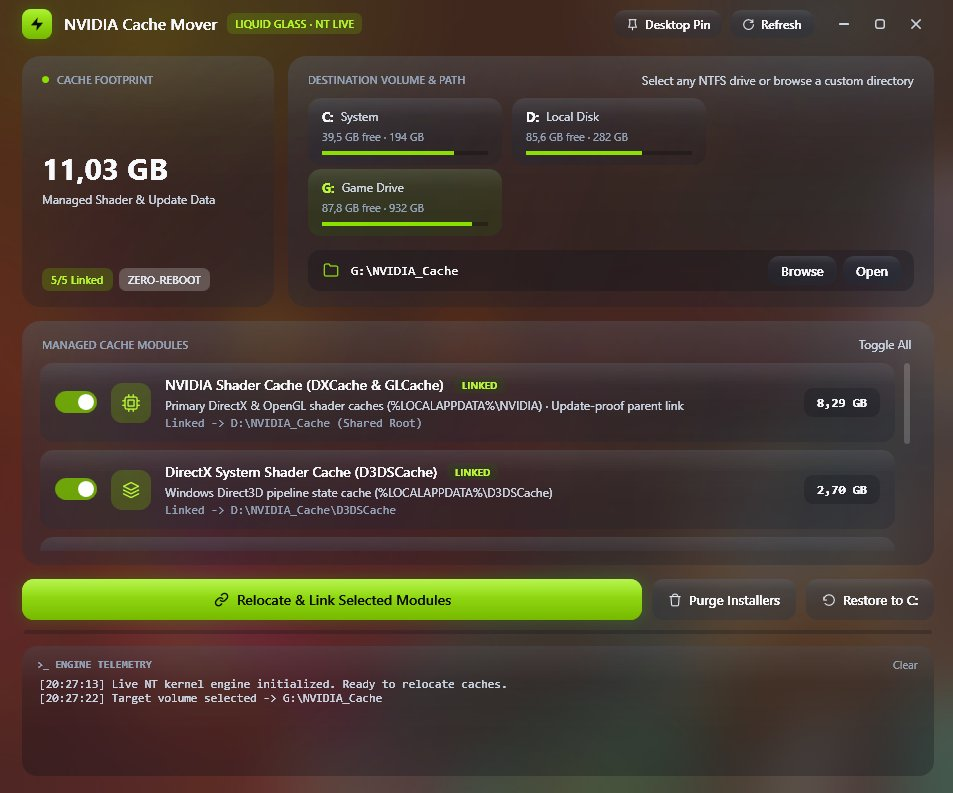

# NVIDIA Cache Mover

[](https://github.com/awm404/NV-Cache-Mover/releases/latest)
-0078D4?style=flat-square)


**Relocate NVIDIA & DirectX shader and driver-installer caches off your `C:` drive to any NTFS volume — live, update-proof, and without booting into Safe Mode.**



---

## Why This Exists

NVIDIA drivers (`DXCache`, `GLCache`, `ComputeCache`), Windows Direct3D (`D3DSCache`), and the NVIDIA App updater (`ota-artifacts`) hardcode their storage locations onto `C:` and routinely consume **10 GB to 40+ GB** of primary SSD space.

Traditionally, moving `DXCache` required:
1. Rebooting into **Windows Safe Mode** (because `explorer.exe`, browsers, and overlays memory-map `.nvph` shader header files as soon as you log in).
2. Manually running `mklink /J` commands in an elevated prompt.
3. Redoing links whenever an NVIDIA driver update wiped and recreated child cache folders like `GLCache`.

**NVIDIA Cache Mover** automates the entire workflow in a single ~225 KB native Windows utility — live on your active desktop, without closing running apps, requiring Administrator privileges, or restarting Windows.

---

## Key Features

- **Zero-Reboot Live NT Lock Release** — Inspects and releases active `.nvph` / `.nvbin` locks held by user-session processes (`explorer.exe`, Chromium/Electron GPU processes, game overlays) in real time without terminating any applications.
- **Driver-Update Proof Architecture** — Redirects parent directories (`%LOCALAPPDATA%\NVIDIA` and `AppData\LocalLow\NVIDIA`) via NTFS Directory Junctions and sets `__GL_SHADER_DISK_CACHE_PATH` (`WM_SETTINGCHANGE` broadcast), so future driver updates delete and recreate `DXCache` / `GLCache` *inside* your target drive without breaking the junction on `C:`.
- **5 Complete Cache Modules** — Relocates DirectX/OpenGL shader caches, Windows `D3DSCache`, sandboxed browser/WebView2 GPU caches, CUDA `ComputeCache`, and NVIDIA App's multi-gigabyte `ota-artifacts` installer cache.
- **One-Click Installer Purge & Safe Restore** — Reclaim ~4 GB of leftover downloaded driver installers anytime, or atomically migrate caches back to `C:` with a single click.
- **Native Windows 11 Liquid Glass UI + Headless CLI** — Borderless Windows 11 Desktop Acrylic (`DWMSBT_TRANSIENTWINDOW`) interface alongside full command-line support for scripts and power users.

---

## Managed Cache Locations

| Module | Default Path on `C:` | Target Subfolder | Notes |
| :--- | :--- | :--- | :--- |
| **NVIDIA Shader Cache** | `%LOCALAPPDATA%\NVIDIA` | `<Target>\Local_NVIDIA` | Covers `DXCache` & `GLCache` at parent level + sets `__GL_SHADER_DISK_CACHE_PATH` |
| **DirectX System Cache** | `%LOCALAPPDATA%\D3DSCache` | `<Target>\D3DSCache` | Windows Direct3D pipeline state cache |
| **Sandboxed Shader Cache** | `%USERPROFILE%\AppData\LocalLow\NVIDIA` | `<Target>\LocalLow_NVIDIA` | Low-integrity GPU shader cache used by browsers, WebView2 & overlays |
| **CUDA / Compute Cache** | `%APPDATA%\NVIDIA\ComputeCache` | `<Target>\ComputeCache` | Compute & AI kernel compilation cache |
| **NVIDIA App OTA Cache** | `%ProgramData%\NVIDIA Corporation\NVIDIA App\UpdateFramework\ota-artifacts` | `<Target>\ota-artifacts` | Downloaded Game Ready / Studio driver packages (~3.5–4.5 GB per update) |

---

## How the Live Lock Engine Works

When `nvwgf2umx.dll` initializes DirectX in a desktop application, it holds three distinct kernel references to `.nvph` cache files:
1. A **memory-mapped view** (`MapViewOfFile`) in the process's virtual address space.
2. A **`Section` object handle** (`CreateFileMappingW`) in the process handle table.
3. A **`File` object handle** (`CreateFileW`) in the process handle table.

Because those processes run under your current Windows user token, `LiveHandleUnlocker` queries `NtQueryInformationFile(FileProcessIdsUsingFileInformation)` to pinpoint only the exact PIDs referencing the target cache folder, copies all unlocked shader binaries first, unmaps matching `.nvph` views (`NtUnmapViewOfSection`), closes matching `File` and `Section` handles (`DuplicateHandle` with `DUPLICATE_CLOSE_SOURCE`), copies the remaining header files, swaps the folder for an NTFS Directory Junction, and lets running apps continue uninterrupted.

---

## Getting Started

### Requirements
- **OS:** Windows 10 or Windows 11 (x64)
- **Target Drive:** Formatted as **NTFS** (required for NTFS Directory Junctions)
- **Runtime:** [.NET 9.0 Desktop Runtime (x64)](https://dotnet.microsoft.com/download/dotnet/9.0) *(not needed if built with `--self-contained true`)*

### GUI Usage
1. Launch `NvidiaCacheMover.exe`.
2. Click one of the detected NTFS volume cards (e.g., `D:\` or `G:\`) or click **Browse** to choose a custom folder.
3. Toggle the cache modules you want to manage and click **Relocate & Link Selected Modules**.

### CLI Usage
```powershell
# Inspect current junction targets and cache footprint
.\NvidiaCacheMover.exe --status

# Relocate and link all cache modules to a target NTFS folder
.\NvidiaCacheMover.exe --move "D:\NVIDIA_Cache"

# Purge leftover downloaded driver installers from ota-artifacts
.\NvidiaCacheMover.exe --clean-ota
```

---

## Building from Source

```powershell
# Framework-dependent single-file (~225 KB, requires .NET 9 Desktop Runtime)
dotnet publish -c Release -r win-x64 --self-contained false -p:PublishSingleFile=true -p:DebugType=None -o dist

# Fully standalone single-file (~65 MB, zero runtime dependencies)
dotnet publish -c Release -r win-x64 --self-contained true -p:PublishSingleFile=true -p:IncludeNativeLibrariesForSelfExtract=true -p:EnableCompressionInSingleFile=true -p:DebugType=None -o dist-standalone
```

---

## Safety & FAQ

- **Does this use real space on `C:` after linking?**  
  No. File Explorer still displays the linked folder at `%LOCALAPPDATA%\NVIDIA` (with a shortcut arrow) and reports the target's size in Properties, but 100% of the bytes live physically on your target drive and consume **0 bytes** on `C:`.
- **Will updating my NVIDIA drivers undo this?**  
  No. Because the junction is placed on the parent `%LOCALAPPDATA%\NVIDIA` folder rather than individual child folders, driver updates that clear/recreate `DXCache` or `GLCache` perform those operations directly inside your target folder.
- **Can deleting a link delete my target files?**  
  `JunctionHelper` strictly checks `FileAttributes.ReparsePoint` before unlinking and never recursively deletes through reparse points. To undo everything cleanly, use the built-in **Restore to C:** button.

---

## Disclaimer

This is an independent open-source system utility and is **not** affiliated with, endorsed by, or sponsored by NVIDIA Corporation or Microsoft Corporation. *NVIDIA*, *GeForce*, and *CUDA* are trademarks and/or registered trademarks of NVIDIA Corporation.
